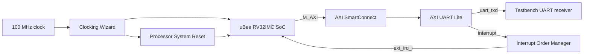

# EHB326E Embedded Systems Portfolio

This repository documents my coursework and future final project for **EHB326E – Embedded Systems**.

**Student:** Kaan Karaali  
**Development environment:** AMD Vivado 2025.2.1  
**Processor platform:** uBee RV32IMC system-on-chip

## Project index

| Work | Status | Verification |
|---|---|---|
| [Homework 1 – uBee SoC with AXI UART Lite](coursework/homework-01-ubee-uart/README.md) | Completed | Vivado behavioral simulation |
| Future homework assignments | Planned | To be added |
| [Final project](Final_Project/README.md) | Planned | To be defined |

## Homework 1 overview

Homework 1 integrates the **uBee RV32IMC SoC** with an AXI UART Lite peripheral in Vivado.



The processor accesses AXI UART Lite through a memory-mapped AXI4-Lite interface. SmartConnect decodes the address and routes the transaction to the UART, which serializes each transmitted byte.

| Configuration | Value |
|---|---:|
| System clock | 100 MHz |
| UART baud rate | 9600 baud |
| UART format | 8N1 |
| AXI UART Lite base address | `0x60000000` |
| Target part | `xc7a100tcsg324-1` |

The behavioral simulation decoded:

```text
Hello from uBee on Arty A7
```

and reported:

```text
PASS: tb_design_1_hello
```

This verifies the simulated transmit path from the processor through AXI SmartConnect and AXI UART Lite to `uart_txd`. It does not claim validation on a physical FPGA board. UART reception and interrupt servicing were outside this testbench's scope.

## Repository structure

```text
ehb326e-embedded-systems/
├── README.md
├── THIRD_PARTY_NOTICES.md
├── coursework/
│   └── homework-01-ubee-uart/
│       ├── README.md
│       ├── rtl/design_1.bd
│       ├── report/main.tex
│       └── evidence/simulation_waveform.png
└── Final_Project/
    └── README.md
```

Vivado build products and temporary files are excluded. Course-provided RTL, testbenches, memory images, and IP are referenced from the upstream repository rather than republished here.

## Topics covered

- RISC-V processor systems
- FPGA-based embedded system design
- Memory maps and memory-mapped I/O
- Base addresses and register offsets
- AXI4-Lite communication
- UART transmission
- Clock and reset generation
- Interrupt routing and PLIC concepts
- SystemVerilog testbenches
- Behavioral simulation and waveform debugging
- Hardware/software co-design

## Attribution

The processor framework used in this coursework is **uBee**, developed by **GSTL-ITU**. The original project is available at [GSTL-ITU/uBee](https://github.com/GSTL-ITU/uBee).

My work in this repository consists of course-specific system integration, Vivado block-design configuration, simulation analysis, and reporting. See [THIRD_PARTY_NOTICES.md](THIRD_PARTY_NOTICES.md) for provenance details.

