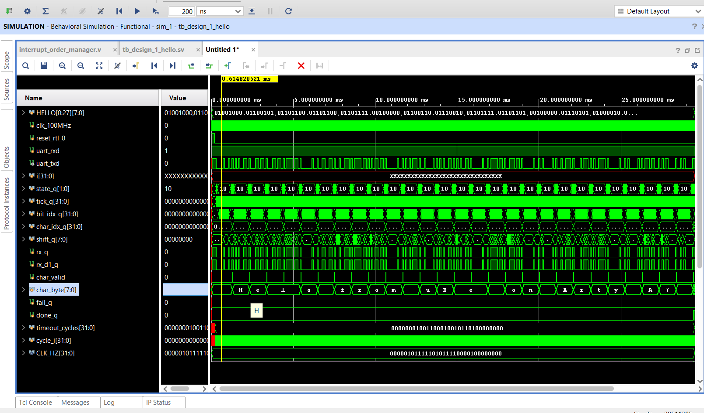

# Homework 1 – uBee SoC and AXI UART Lite

## Objective

The objective was to reproduce the Chapter 2 uBee system in Vivado, connect the RV32IMC processor system to AXI UART Lite, configure clock and reset, route the UART interrupt, and verify the transmit path through behavioral simulation.

## Main blocks

- uBee RV32IMC SoC with IMEM and DMEM
- AXI SmartConnect
- AXI UART Lite at `0x60000000`
- Clocking Wizard at 100 MHz
- Processor System Reset
- Interrupt Order Manager
- XConstant for unused interrupt inputs
- SystemVerilog UART testbench

## Memory-mapped UART

| Register | Offset | Absolute address |
|---|---:|---:|
| RX FIFO | `0x00` | `0x60000000` |
| TX FIFO | `0x04` | `0x60000004` |
| Status | `0x08` | `0x60000008` |
| Control | `0x0C` | `0x6000000C` |

When the processor stores a byte at `0x60000004`, the transaction leaves the SoC through `M_AXI`. SmartConnect forwards it to AXI UART Lite, which writes the byte into its TX FIFO and serializes it on `uart_txd`.

## Verification

```text
Clock frequency: 100 MHz
UART baud rate:  9600 baud
Frame format:    8N1
```

The testbench decoded `Hello from uBee on Arty A7` and reported `PASS: tb_design_1_hello`.



The test verifies behavioral simulation of instruction execution and UART transmission. It does not verify UART reception, interrupt servicing, or operation on a physical board.

## Portfolio artifacts

- [`rtl/design_1.bd`](rtl/design_1.bd) – configured Vivado block design
- [`report/main.tex`](report/main.tex) – report source with the student number omitted from the public copy
- [`evidence/simulation_waveform.png`](evidence/simulation_waveform.png) – simulation result

The underlying uBee IP, testbench, interrupt helper, and memory images were supplied by the course repository and are intentionally not duplicated in this public portfolio. See the [upstream project](https://github.com/GSTL-ITU/uBee) and the repository's [third-party notice](../../THIRD_PARTY_NOTICES.md).

